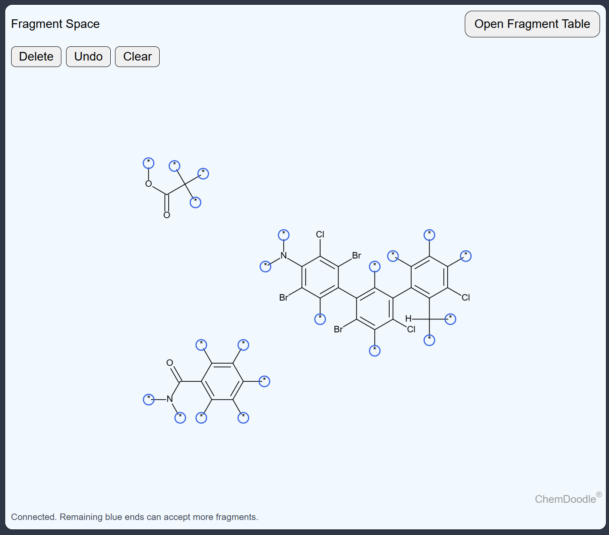

# Fragment Canvas

A web-based molecular fragment canvas for assembling chemical structures; allows adding, connecting, moving, deleting, and undoing structure fragments. Built using ChemDoodle and RDKit.js.



## Local setup

### Requirements

- A modern web browser
- Python 3 or another local HTTP server

### Running the project

```bash
git clone https://github.com/biochem-learning/frag_canvas_protoype.git
cd spectrum-app-v2
python3 -m http.server 8000
```

On Windows, use:

```powershell
py -m http.server 8000
```

Open the applications in your browser: <http://localhost:8000>

## Acknoledgement

This project uses a modified version of [ChemDoodle Web Components](https://web.chemdoodle.com/) by iChemLabs, licensed under the GNU General Public License v3.0 (GPLv3), and [RDKit.js](https://github.com/rdkit/rdkit-js), licensed under the BSD 3-Clause License.
